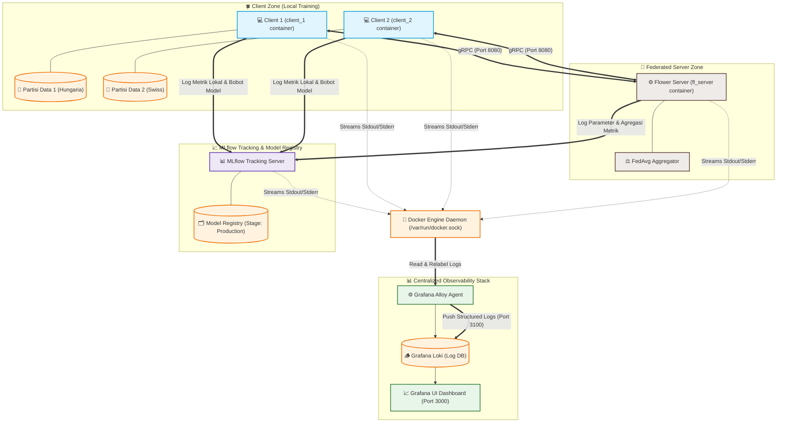

# Experiment Tracking and Model Registry on Heart Disease Classification using MLflow and Flower

Proyek ini merupakan sistem pembelajaran terfederasi (**Federated Learning**) tingkat lanjut untuk klasifikasi penyakit jantung menggunakan dataset **UCI Heart Disease**. Sistem ini mengintegrasikan framework **Flower** untuk koordinasi server-client, **MLflow** untuk *experiment tracking* & *model registry* tingkat lanjut, serta **Grafana Loki Stack** untuk observabilitas dan pengumpulan log kontainer secara tersentralisasi.

---

## 📐 Arsitektur Sistem & Alur Kerja

Berikut adalah visualisasi arsitektur sistem pembelajaran terfederasi beserta sistem *tracking* dan *monitoring* terintegrasi:



---

## ⚡ Fitur Utama

### 1. Federated Learning Tingkat Lanjut (Flower + FedAvg)
* Orkestrasi pembelajaran terfederasi menggunakan **Flower Framework** secara aman tanpa membagikan data mentah client.
* Menggunakan algoritma **Federated Averaging (FedAvg)** untuk menggabungkan bobot model lokal menjadi model global.

### 2. Pengukuran Bobot Model & Pembuktian FedAvg
* **Tanpa Random Hash**: Client ID bawaan Flower yang acak diabaikan dan diganti dengan indeks sequential bersih (`client_1`, `client_2`, dst.) agar visualisasi di MLflow konsisten dan rapi.
* **Metrik Bobot Model**: Mengukur nilai L2 norm dari bobot lokal model (`param_norm`) dan perbedaan pembaruan bobot lokal terhadap model global sebelumnya (`delta_norm`) sebelum dikirim ke server. Ini memberikan transparansi penuh untuk pembuktian rumus matematika FedAvg.

### 3. MLflow Tracking & Model Registry Otomatis
* **Standardized Run Naming**: Penamaan run terstruktur secara otomatis: `Federated_Server_Logistic_Regression_[Timestamp]` dan `Federated_Client_[ID]_Logistic_Regression_[Timestamp]`.
* **Best Model Registry**: Hanya model global terbaik (berdasarkan akurasi validasi teragregasi tertinggi lintas seluruh ronde) yang didaftarkan ke *Model Registry*, menghindari sampah versi model per ronde.
* **Production Promotion**: Model terbaik secara otomatis ditransisikan ke tahap `"Production"`, diberikan metadata tags lengkap (`validation_accuracy`, `best_round`, `algorithm`, `total_participating_clients`), serta ditautkan ke alias `"champion"` dan `"Production"` menggunakan `MlflowClient`. Versi model lama diarsipkan secara otomatis.

### 4. Observabilitas Tersentralisasi (Grafana Loki & Grafana Alloy)
* Pengumpulan log aktif dan otomatis dari seluruh container (`fl_server`, `client_1`, `client_2`, `mlflow`) dengan menghubungkan soket Docker `/var/run/docker.sock`.
* Dashboard **Docker Container Logs** siap pakai di Grafana (Port 3000) untuk mempermudah pencarian log, visualisasi volume log, filter container, dan monitoring *error* / *warning* secara real-time.

### 5. Interactive Streamlit Testing Dashboard (`demo_app.py`)
* **Interactive Parameter Tuning**: Customize the number of rounds, Scikit-learn Logistic Regression solver, penalty, max iterations, and Flower federation strategy parameters (Fraction Fit, Fraction Evaluate, Min Fit/Evaluate Clients) instantly from the UI.
* **Docker Compose Orchestration**: Run, recreate, and stop the entire containerized Federated Learning stack with one click, utilizing security group bypasses (`sg docker -c`) for privilege-less process spawning.
* **MLflow Evaluation Artifacts Viewer**: Retrieve classification reports and confusion matrix plots directly from the MLflow model registry and render them inside the dashboard dynamically.
* **Local CSV Dataset Uploader**: Easily upload and overwrite local dataset slices (Server, Client 1, and Client 2 datasets) for blackbox robustness testing.
* **Scrollable Log Box Terminals**: Read clean terminal logs in custom-styled, scrollable dark consoles with levels (Info, Warning, Error) filtering.

---

## 🔌 Pemetaan Port Layanan

| Layanan | Port Eksternal (Host) | Port Internal (Container) | Protokol | Deskripsi |
| :--- | :--- | :--- | :--- | :--- |
| **Streamlit Dashboard** | `8501` | *N/A (Host)* | HTTP | Interactive Testing Portal Dashboard |
| **Grafana** | `3000` | `3000` | HTTP | Dashboard Visualisasi Log & Monitoring |
| **Loki** | `3100` | `3100` | HTTP | Basis data log tersentralisasi |
| **MLflow Server** | `5000` | `5000` | HTTP | Experiment Tracking & Model Registry |
| **FL Server (Flower)** | `8080` | `8080` | TCP (gRPC) | Server Pembelajaran Terfederasi |
| **Grafana Alloy** | *N/A* | *Internal* | HTTP | Agen pengumpul log kontainer modern |

---

## 📂 Struktur Proyek

```text
.
├── dashboard/          # Modul pendukung Streamlit dashboard (Control Panel, Health, Monitor, dsb)
│   ├── commands.py     # Koleksi terisolasi untuk seluruh CLI command Docker & Local
│   ├── process_manager.py # Manajemen eksekusi subprocess & Docker
│   ├── styles.py       # Custom CSS & font untuk estetika premium
│   └── tab_*.py        # File visualisasi komponen tab Streamlit
├── data/               # Dataset mentah dan hasil pemrosesan
│   ├── raw/
│   └── processed/
├── src/                # Source code utama
│   ├── client/         # Implementasi Flower Client & kalkulasi bobot L2
│   ├── configs/        # Konfigurasi global (MLflow, Flower, dsb)
│   ├── server/         # Implementasi Flower Server, FedAvg & Registry Automation
│   ├── models/         # Arsitektur model (Scikit-learn Logistic Regression)
│   └── utils/          # Fungsi pembantu (data loading, preprocessing)
├── monitoring/         # Konfigurasi Grafana Loki, Alloy, & Grafana
├── Dockerfile.client   # Dockerfile teroptimasi (slim size dengan Astral UV)
├── Dockerfile.server   # Dockerfile teroptimasi (slim size dengan Astral UV)
├── docker-compose.yml  # Orkestrasi seluruh layanan FL + Observabilitas
├── demo_app.py         # Entrypoint portal Streamlit Dashboard
└── pyproject.toml      # Manajemen dependensi Python & konfigurasi Ruff/Black
```

---

## 🛠️ Prasyarat

Sebelum memulai, pastikan sistem Anda telah menginstal:
* [Python 3.11+](https://www.python.org/)
* [UV](https://github.com/astral-sh/uv) (Pengelola paket Python cepat)
* [Docker](https://www.docker.com/) & [Docker Compose](https://docs.docker.com/compose/)

---

## ⚙️ Cara Menjalankan

### 1. Menggunakan Streamlit Dashboard (Sangat Direkomendasikan)

Ini adalah metode termudah untuk melakukan testing parameter, monitoring metrik, dan mengunggah dataset baru secara interaktif:

```bash
# Install seluruh dependensi dan jalankan Streamlit portal
uv run streamlit run demo_app.py
```
Arahkan peramban Anda ke [http://localhost:8501](http://localhost:8501) untuk mengakses portal testing Anda secara langsung.

### 2. Menggunakan Docker Compose (Command Line)

Ini adalah cara tercepat untuk menjalankan seluruh ekosistem FL beserta sistem monitoring log tersentralisasi tanpa dashboard:

```bash
docker-compose up --build
```

Setelah semua kontainer aktif:
- **MLflow Dashboard**: Buka [http://localhost:5000](http://localhost:5000) untuk melihat eksperimen.
- **Grafana Loki Logs**: Buka [http://localhost:3000](http://localhost:3000) (User: `admin` | Sandi: `admin`).
  - Pilih menu **Dashboards** -> folder **Monitoring** -> pilih dashboard **Docker Container Logs** untuk memantau log secara langsung.

### 3. Menjalankan Secara Lokal (Langkah Manual)

Jika ingin menjalankan tanpa Docker, siapkan virtual environment terlebih dahulu:

```bash
# 1. Install dependencies menggunakan UV
uv sync

# 2. Jalankan MLflow Server lokal
mlflow server --host 127.0.0.1 --port 5000

# 3. Jalankan FL Server (Gunakan Terminal Baru)
export MLFLOW_TRACKING_URI=http://127.0.0.1:5000
export PYTHONPATH=$PYTHONPATH:$(pwd)/src
python -m server.server

# 4. Jalankan FL Client (Gunakan Terminal Baru)
export SERVER_ADDRESS=127.0.0.1:8080
export DATASET_PATH=data/processed/heart_disease_cleaned.csv
export PYTHONPATH=$PYTHONPATH:$(pwd)/src
python -m client.client
```

---

## 👤 Author

* **Muhammad Attan** - [2022610013.attan@itp.ac.id](mailto:2022610013.attan@itp.ac.id)

---

## 📄 License

Proyek ini dilisensikan di bawah **MIT License** - lihat berkas [LICENSE](LICENSE) untuk detailnya.
