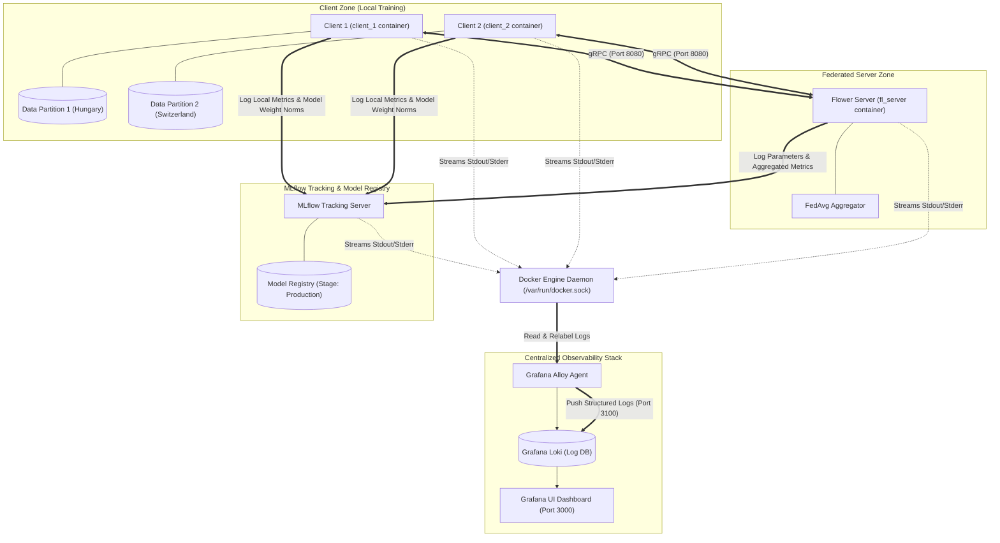

# Experiment Tracking and Model Registry on Heart Disease Classification using MLflow and Flower

This project implements an end-to-end Federated Learning (FL) system for heart disease classification using the UCI Heart Disease dataset. The platform integrates **Flower** for federated server-client orchestration, **MLflow** for experiment tracking and model registry automation, **Grafana Alloy** and **Grafana Loki** for container log collection and observability, and an interactive **Streamlit Dashboard** (`demo_app.py`) for workflow execution, monitoring, and dataset management.

---

## System Architecture & Workflow

The system is organized into decoupled layers to ensure security, observability, and reproducible machine learning experiments:



---

## Core Source Code Modules (`src/`)

The core application logic is located under `src/` and split into clear functional modules:

- **`src/client/client.py`**: Entry point for federated client nodes. Initializes the Flower client connection using gRPC and starts local model training.
- **`src/server/server.py`**: Entry point for the federated server. Configures the aggregation strategy, initializes gRPC services, and automates model registration to MLflow upon run completion.
- **`src/configs/config.py`**: Global configuration module managing environment variables, server host/ports, MLflow tracking URIs, default hyperparameter fallbacks, and training round settings.
- **`src/models/model.py`**: Model architecture definition for binary classification using Scikit-learn Logistic Regression, supporting solvers (`saga`, `lbfgs`, `liblinear`, `newton-cg`), penalties (`l2`, `l1`, `none`), and regularization strengths (`C`).
- **`src/data/dataset.py`**: Dataset loader and preprocessing module that converts target labels into binary indicators and splits datasets into training and evaluation sets.
- **`src/utils/`**:
  - **`client_utils.py`**: Implements custom Flower `NumPyClient` logic (`HeartDiseaseClient`). Calculates local loss, accuracy, precision, recall, and L2 weight norms (`param_norm`, `delta_norm`), logging metrics per round directly to MLflow.
  - **`server_utils.py`**: Custom Flower `FedAvg` strategy (`AggregateCustomMetricsStrategy`) integrated with MLflow. Calculates aggregated validation metrics across clients, selects the best performing round, registers the top model to MLflow Model Registry, and promotes it to `"Production"`.
  - **`data_utils.py`**: Utility helper functions for extracting dataset class distributions.
  - **`eval_utils.py`**: Evaluation utilities for logging classification reports, confusion matrix plots, precision, recall, and accuracy metrics.
  - **`model_utils.py`**: Helper routines for setting and extracting Scikit-learn model coefficients and intercepts.

---

## Interactive Demonstration Dashboard (`demo_app.py` & `dashboard/`)

The web UI is built using Streamlit and located in `demo_app.py` along with modular tab components under `dashboard/`:

- **`demo_app.py`**: Main application entry point providing the overall layout, dynamic telemetry auto-refresh, metric summary cards, and navigation tabs.
- **`dashboard/tab_control_panel.py`**: Control center for configuring training parameters (rounds, solvers, penalty, C, max iterations, fraction fit/eval). Provides buttons to launch or stop the Docker Compose stack, a file uploader with a maximum size limit of **1 MB** to overwrite client/server CSV datasets, and a live dark-themed execution log viewer.
- **`dashboard/tab_monitor.py`**: Live federated training charts (accuracy and loss curves per round) and MLflow model evaluation artifacts viewer (confusion matrix and classification report).
- **`dashboard/tab_health.py`**: Docker infrastructure health monitor checking status for all services (`fl_server`, `client_1`, `client_2`, `mlflow_server`, `loki`, `alloy`).
- **`dashboard/tab_logs.py`**: System log explorer featuring container filters and log level keyword highlighting.
- **`dashboard/process_manager.py` & `dashboard/commands.py`**: Process management and CLI command handlers for non-blocking execution of Docker Compose commands.

---

## Centralized Monitoring Stack (Grafana & Alloy)

Log collection and visualization are handled by Grafana and Grafana Alloy:

- **Grafana Alloy Agent**: Runs as a containerized agent with access to `/var/run/docker.sock`. It automatically discovers and reads container stdout/stderr log streams, attaches container metadata labels, and pushes formatted log records to Loki on port `3100`.
- **Grafana**: Web interface running on port `3000` with pre-configured data sources (Grafana Loki) and automated dashboard provisioning for container log monitoring.

---

## Docker Infrastructure & Containerization

- **`Dockerfile.server`**: Optimized server image built on `python:3.11-slim` using Astral `uv` for fast dependency installation. Exposes port `8080` for Flower gRPC service.
- **`Dockerfile.client`**: Optimized client image for containerized nodes (`client_1`, `client_2`) loaded with client code dependencies.
- **`docker-compose.yml`**: Defines the multi-container stack:
  - `mlflow_server` (Port 5000): MLflow tracking server and model registry.
  - `fl_server` (Port 8080): Federated server orchestrator.
  - `client_1` & `client_2`: Federated client nodes with isolated dataset volumes.
  - `loki` (Port 3100): Centralized log store.
  - `alloy`: Container log collector forwarding Docker engine logs to Loki.
  - `grafana` (Port 3000): Visual observability dashboard.

---

## Dependency & Project Management (`pyproject.toml`)

Project dependencies and development tools are managed using Astral `uv` according to PEP 621 standards:

- **Core Dependencies**: `flwr`, `mlflow`, `scikit-learn`, `pandas`, `matplotlib`, `seaborn`, `dvc[s3]`.
- **Development Tools**: `ruff`, `black`, `pre-commit`, `pytest`.

---

## Service Port Mapping

| Service | Host Port | Container Port | Protocol | Description |
| :--- | :--- | :--- | :--- | :--- |
| **Streamlit Dashboard** | `8501` | *N/A (Host)* | HTTP | Interactive Control & Monitoring Dashboard |
| **Grafana** | `3000` | `3000` | HTTP | Container Log Visualizations & Monitoring |
| **Loki** | `3100` | `3100` | HTTP | Centralized Log Storage Database |
| **MLflow Server** | `5000` | `5000` | HTTP | Experiment Tracking & Model Registry Portal |
| **FL Server (Flower)** | `8080` | `8080` | TCP (gRPC) | Federated Learning Communication Channel |

---

## Prerequisites

Ensure your system has the following software installed:
- [Python 3.11+](https://www.python.org/)
- [Astral UV](https://github.com/astral-sh/uv)
- [Docker](https://www.docker.com/) and [Docker Compose](https://docs.docker.com/compose/)

---

## Getting Started

### Method 1: Interactive Streamlit Dashboard (Recommended)

Run the dashboard application directly using `uv`:

```bash
uv run streamlit run demo_app.py
```

Access the portal in your web browser at `http://localhost:8501`.

### Method 2: Docker Compose Execution

To launch the full federated learning stack along with MLflow and Grafana monitoring:

```bash
docker-compose up --build
```

After startup:
- **MLflow Tracking**: Visit `http://localhost:5000`
- **Grafana Monitoring**: Visit `http://localhost:3000` (Default credentials: `admin` / `admin`)

### Method 3: Local Standalone Execution

To run services manually on local processes:

```bash
# 1. Sync project dependencies
uv sync

# 2. Start local MLflow server
mlflow server --host 127.0.0.1 --port 5000

# 3. Start FL Server (in a new terminal)
export MLFLOW_TRACKING_URI=http://127.0.0.1:5000
export PYTHONPATH=$PYTHONPATH:$(pwd)/src
python -m src.server.server

# 4. Start FL Client (in a new terminal)
export SERVER_ADDRESS=127.0.0.1:8080
export DATASET_PATH=data/processed/heart_disease_hungary_cleaned.csv
export CLIENT_ID=client_1
export MLFLOW_TRACKING_URI=http://127.0.0.1:5000
export PYTHONPATH=$PYTHONPATH:$(pwd)/src
python -m src.client.client
```

---

## Author

- **Muhammad Attan** - [2022610013.attan@itp.ac.id](mailto:2022610013.attan@itp.ac.id)

---

## License

This project is licensed under the MIT License - see the [LICENSE](LICENSE) file for details.
