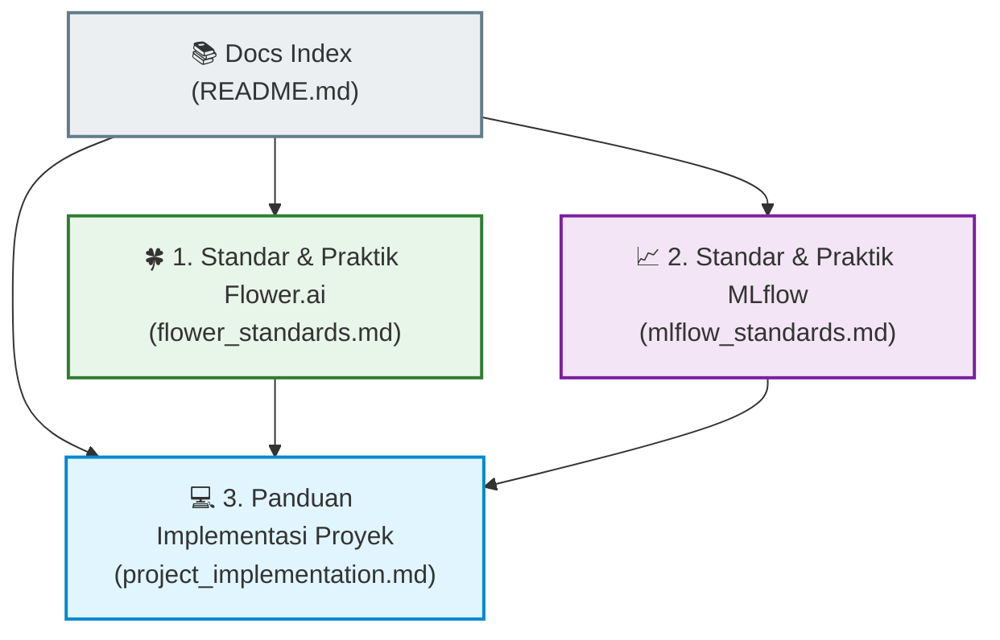

# 📚 Heart Disease Federated Learning - Standard Documentation

Selamat datang di repositori dokumentasi standar untuk proyek **Pembelajaran Terfederasi (Federated Learning)** klasifikasi penyakit jantung menggunakan dataset UCI Heart Disease.

Dokumentasi ini disusun berdasarkan standar resmi dari **Flower.ai (v1.13+)** dan **MLflow (v2.x)** untuk memastikan pengembangan sistem pembelajaran terfederasi, pelacakan eksperimen (*experiment tracking*), manajemen model (*model registry*), serta observabilitas berjalan secara profesional, terstruktur, dan sesuai standar industri (*production-grade*).

---

## 🗺️ Peta Navigasi Dokumentasi

Dokumentasi ini dibagi menjadi 3 pilar utama untuk mempermudah pemahaman arsitektur dan implementasi standar:

### 1. [🍀 Standar & Praktik Terbaik Flower.ai](file:///home/attmhd/Dokumen/Kuliah/TA/heart-disease-fl/docs/flower_standards.md)
*   **Arsitektur Modern**: Pengenalan konsep `ServerApp` dan `ClientApp` yang memisahkan logika aplikasi dengan infrastruktur jaringan (*deployment layer*).
*   **Transisi API**: Migrasi dari API lama (`start_server` / `start_client`) ke API internal non-deprecated berbasis gRPC bidi.
*   **Kustomisasi Strategy**: Panduan pembuatan strategi kustom dengan menimpa fungsi callback (`aggregate_fit`, `aggregate_evaluate`, `evaluate`).

### 2. [📈 Standar & Praktik Terbaik MLflow](file:///home/attmhd/Dokumen/Kuliah/TA/heart-disease-fl/docs/mlflow_standards.md)
*   **Struktur Eksperimen FL**: Teknik pemetaan pembelajaran terfederasi yang terdistribusi ke dalam struktur hierarkis **Parent-Child Runs** di MLflow.
*   **Model Registry Tingkat Lanjut**: Penggunaan `MlflowClient` untuk pemeliharaan siklus hidup model (*model lifecycle*), promosi otomatis ke stage `"Production"`, pemberian tag, deskripsi, dan manajemen alias (`@Production`, `@champion`).
*   **Pelacakan Parameter Fisik**: Pelacakan metrik kebugaran bobot model (`param_norm` dan `delta_norm`) untuk membuktikan kebenaran matematis FedAvg.

### 3. [💻 Panduan Implementasi Proyek](file:///home/attmhd/Dokumen/Kuliah/TA/heart-disease-fl/docs/project_implementation.md)
*   **Pemetaan Kode Proyek**: Penjelasan bagaimana codebase dalam `src/` mengadopsi standar Flower dan MLflow.
*   **Observabilitas Tersentralisasi**: Integrasi dengan Grafana Loki dan Promtail untuk memantau log container secara real-time.
*   **Alur Kerja Reproduksibilitas**: Pengelolaan dataset terpartisi, pelacakan eksperimen, dan penataan container Docker.

---

> [!NOTE]
> Semua standar dalam dokumentasi ini telah diimplementasikan sepenuhnya pada codebase proyek ini di direktori `src/client` dan `src/server`.

> [!TIP]
> Untuk hasil terbaik saat membaca atau mengembangkan proyek ini, pastikan Anda memahami alur pengiriman parameter model terfederasi dan bagaimana MLflow melacak metrik per ronde sebelum menganalisis visualisasi pada Grafana atau dashboard MLflow.
