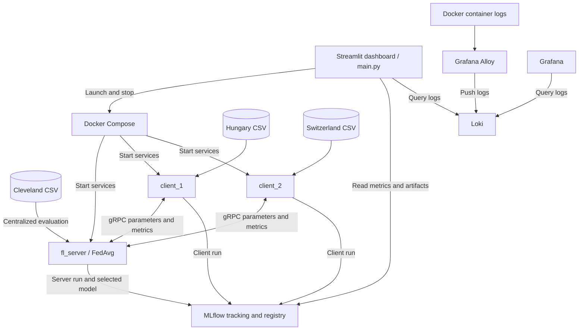
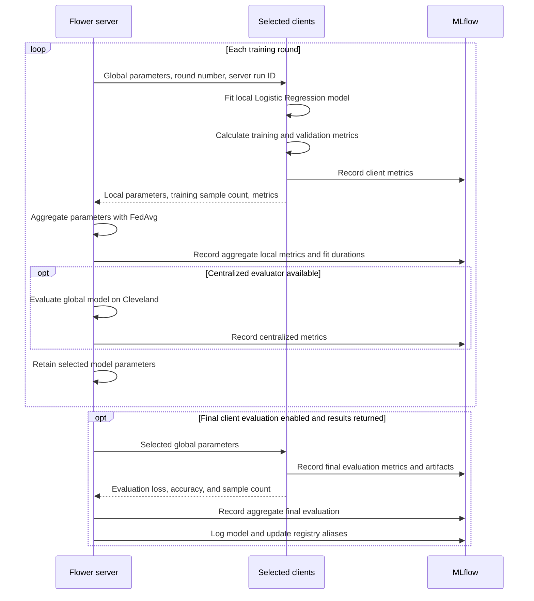

# Architecture and Workflow

[Documentation overview](README.md)

## Services

Docker Compose defines seven services on the `fl_network` bridge network. The Streamlit dashboard runs separately on the host.

| Service | Function | Published port |
| --- | --- | --- |
| `mlflow_server` | Experiment tracking and model registry | `5000` |
| `fl_server` | Flower server and FedAvg aggregation | `8080` |
| `client_1` | Local training on Hungary data | None |
| `client_2` | Local training on Switzerland data | None |
| `loki` | Container log storage and query API | `3100` |
| `alloy` | Docker container discovery and log collection | None |
| `grafana` | Log visualization with provisioned dashboards | `3000` |

## System diagram



The CSV arrows show which partition each component loads. Compose mounts the entire `./data` directory at `/app/data` in the server and both clients. Flower exchanges model parameters, sample counts, and metrics.

## Startup

1. MLflow starts and passes its port healthcheck.
2. The Flower server starts, opens a parent MLflow run, and builds `MLflowStrategy`.
3. The strategy loads the Cleveland evaluation split when its configured file is available and readable.
4. The server opens its gRPC listener at `0.0.0.0:8080`.
5. After the server port healthcheck passes, both clients load their data, initialize their estimators, and connect to `fl_server:8080`.

Each client initializes model parameters by fitting up to five training samples from each available class. The server obtains initial parameters from a client and records centralized baseline metrics at round 0 when its evaluator is active.

## Training rounds



FedAvg weights each client's model parameters by its training sample count:

```text
global_parameters = sum(client_sample_count * client_parameters)
                    / sum(client_sample_count)
```

Client validation metrics returned by `fit()` describe each client's model after local training. Centralized metrics describe the aggregated global model.

## Model selection and final evaluation

When centralized evaluation is active, the strategy retains the parameters with the highest Cleveland accuracy after round 0. When the centralized dataset path does not exist, it selects rounds using `fedavg_val_accuracy`, the weighted average of local validation accuracies. Equal accuracy values retain the earlier selected round.

Client evaluation requests are sent only in the final round. The server sends the selected parameters, or the latest parameters if no earlier candidate was retained. Clients evaluate that global model on their local evaluation splits. The server logs the model from the final evaluation aggregation callback when aggregate results are available.

## Storage

| Content | Configuration |
| --- | --- |
| Datasets | Host `./data` mounted at `/app/data` in the server and clients |
| MLflow artifacts | Host `./mlruns` mounted at `/mlruns` in MLflow, the server, and clients |
| MLflow metadata | SQLite backend `sqlite:///mlflow.db` inside the MLflow container |
| Loki data | Named volume `loki_data` mounted at `/loki` |
| Grafana data | Named volume `grafana_data` mounted at `/var/lib/grafana` |
| Dashboard execution output | Host file `local_fl_run.log` |

Both Dockerfiles use `python:3.11-slim`, install dependencies from `pyproject.toml` with uv, and set `PYTHONPATH=/app/src`.
