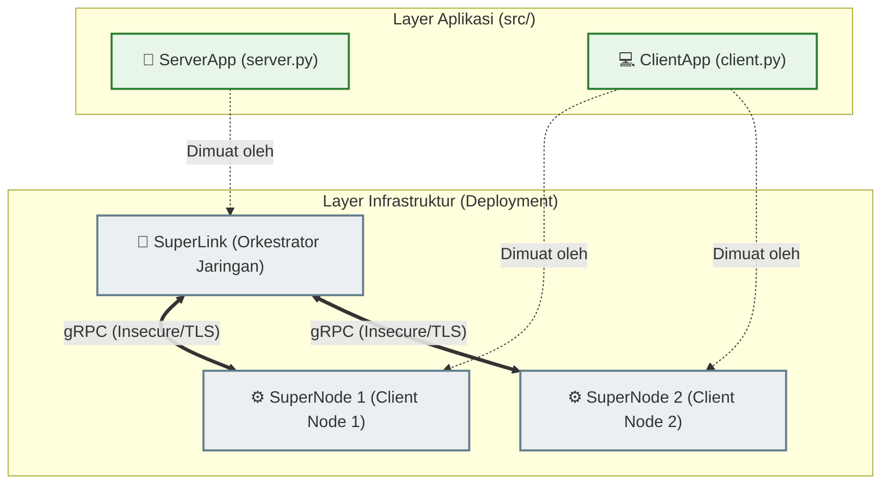
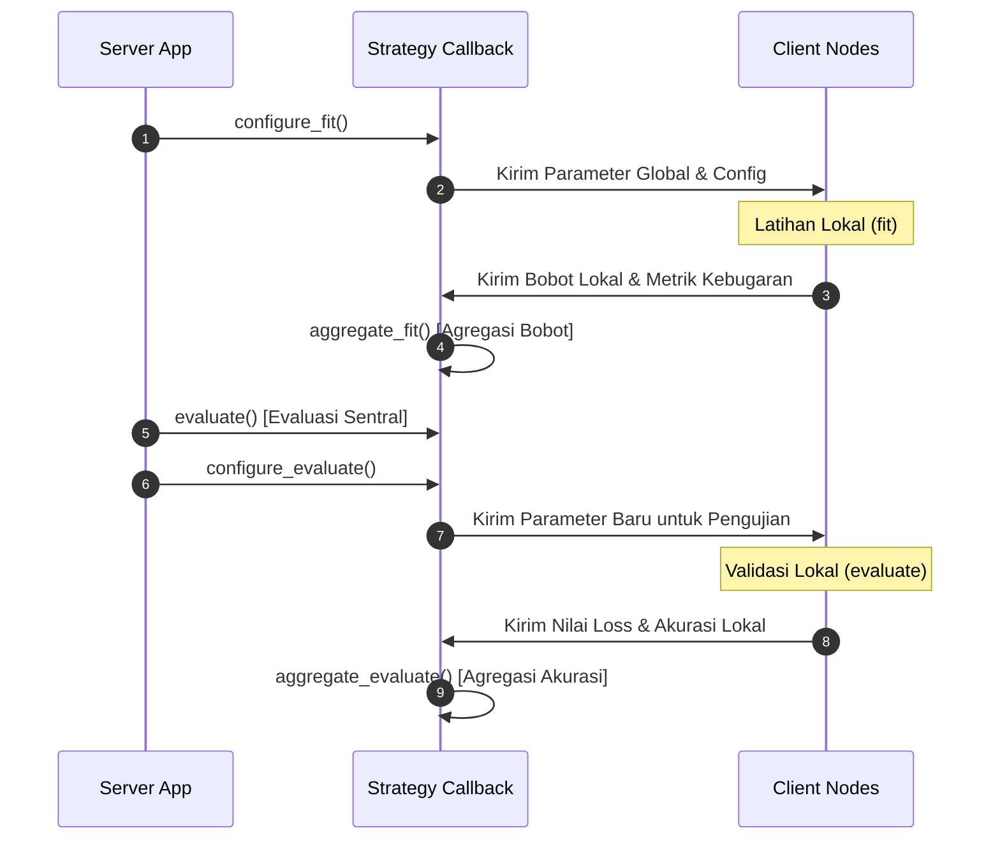

# 🍀 Standar & Praktik Terbaik Flower.ai (v1.13+)

Dokumen ini menjelaskan standar dan praktik terbaik dalam menggunakan **Flower Framework (flwr)** untuk mengembangkan aplikasi pembelajaran terfederasi (*Federated Learning*) skala produksi, dengan fokus khusus pada arsitektur modern berbasis `ServerApp`/`ClientApp` serta kustomisasi strategi.

---

## 1. Arsitektur Modern Flower: `ServerApp` & `ClientApp`

Pada versi **Flower 1.13+**, arsitektur Flower mengalami evolusi besar dari berbasis skrip monolitik menjadi arsitektur berbasis aplikasi yang modular. Pemisahan ini memisahkan antara **logika aplikasi** (*what to compute*) dengan **infrastruktur deployment** (*how/where to deploy*).



### Komponen Utama Arsitektur Baru:
1.  **`ClientApp`**: Merepresentasikan aplikasi lokal yang berjalan di sisi client/node. Bertugas menerima bobot global, melatih model pada dataset lokal, dan mengirimkan kembali pembaruan parameter beserta metrik.
2.  **`ServerApp`**: Berjalan di sisi server/hub utama. Bertugas mengelola siklus pelatihan terfederasi, menentukan strategi agregasi (seperti `FedAvg`), dan mengoordinasikan pengiriman bobot global ke client yang terpilih.
3.  **`Context`**: Objek pembawa state/konfigurasi yang dikirimkan oleh sistem runtime Flower ke dalam pabrik pembuat aplikasi (`client_fn` dan `server_fn`).

---

## 2. Migrasi API: Menghindari Deprecation Warnings

> [!WARNING]
> Memanggil langsung `flwr.server.start_server()` dan `flwr.client.start_client()` merupakan fitur yang **DEPRECATED** (usang) pada Flower versi terbaru dan akan dihapus sepenuhnya.

Penyebab deprecation ini karena API lama menggabungkan logika aplikasi dan runtime gRPC secara erat, sehingga menyulitkan proses skaling dan deployment di lingkungan serverless atau cloud modern.

### Perbandingan API Lama vs API Baru

| Aspek | API Lama (Deprecated) | API Baru (Direkomendasikan / Standard) |
| :--- | :--- | :--- |
| **Sisi Server** | `fl.server.start_server(strategy=...)` | `app = fl.server.ServerApp(server_fn=server_fn)` |
| **Sisi Client** | `fl.client.start_client(client=...)` | `app = fl.client.ClientApp(client_fn=client_fn)` |
| **Pemuatan** | Dijalankan langsung sebagai skrip Python biasa. | Dimuat via CLI: `flower-superlink` dan `flower-superexec`. |
| **Pemisahan** | Mengunci port gRPC secara hardcode di dalam kode. | Jaringan diatur sepenuhnya oleh runtime orkestrator Flower. |

### Menggunakan API Non-Deprecated untuk Legacy Execution
Jika Anda masih menggunakan Docker Compose tradisional atau menjalankan skrip via Python langsung (tanpa orkestrator penuh `flower-superexec`), gunakan API internal non-deprecated dari runtime Flower untuk menginisialisasi server dan client gRPC:

#### Inisialisasi Server (Non-Deprecated Legacy):
```python
from flwr.server.compat.app import init_defaults, run_fl
from flwr.server.superlink.fleet.grpc_bidi.grpc_server import start_grpc_server

# 1. Inisialisasi komponen server & konfigurasi standar
initialized_server, initialized_config = init_defaults(
    server=None,
    config=fl.server.ServerConfig(num_rounds=5),
    strategy=strategy,
)

# 2. Mulai server gRPC secara eksplisit
grpc_server = start_grpc_server(
    client_manager=initialized_server.client_manager(),
    server_address="0.0.0.0:8080",
)

# 3. Jalankan siklus pembelajaran terfederasi
try:
    run_fl(server=initialized_server, config=initialized_config)
finally:
    grpc_server.stop(grace=1)
```

#### Inisialisasi Client (Non-Deprecated Legacy):
```python
from flwr.compat.client.app import start_client_internal

# Jalankan client menggunakan koneksi dua arah gRPC internal
start_client_internal(
    server_address="127.0.0.1:8080",
    node_config={},
    client=your_client.to_client(),
    insecure=True,
)
```

---

## 3. Kustomisasi Strategi Agregasi (`MLflowStrategy`)

Strategi Flower mengatur seluruh alur agregasi bobot model dan evaluasi global. Dengan mewarisi kelas bawaan seperti `flwr.server.strategy.FedAvg`, Anda dapat menyuntikkan logika bisnis tambahan pada siklus FL.



### Callback Utama yang Dapat Di-override:

1.  **`configure_fit(server_round, parameters, client_manager)`**:
    Menentukan instruksi khusus (seperti hyperparameter lokal) yang akan dikirimkan ke client sebelum ronde pelatihan dimulai.
2.  **`aggregate_fit(server_round, results, failures)`**:
    Menerima bobot lokal dari seluruh client yang berhasil menyelesaikan latihan. Di sinilah formula matematis **Federated Averaging (FedAvg)** dihitung:
    $$\theta_{t+1} = \sum_{k=1}^{K} \frac{n_k}{N} \theta_t^k$$
3.  **`evaluate(server_round, parameters)`**:
    Callback opsional untuk melakukan **Centralized Evaluation** di sisi server menggunakan dataset independen yang dimiliki oleh server admin (jika ada).
4.  **`configure_evaluate(server_round, parameters, client_manager)`**:
    Menentukan bobot model mana yang akan dikirimkan ke client untuk divalidasi secara lokal.
5.  **`aggregate_evaluate(server_round, results, failures)`**:
    Menerima dan mengagregasikan nilai loss dan akurasi yang dihitung secara independen pada dataset validasi lokal masing-masing client.

---

## 4. Konversi Parameter Model: NDArrays <=> Parameters

Bobot model dalam Flower dikirimkan melalui jaringan gRPC dalam bentuk objek terkompresi `flwr.common.Parameters` (biasanya dalam bytes serializer). Namun, pustaka ML seperti Scikit-learn, PyTorch, dan TensorFlow menggunakan array NumPy (`NDArrays`).

Gunakan helper resmi dari Flower untuk melakukan transformasi ini tanpa merusak struktur bobot:

```python
# Dari Parameters (gRPC) ke List of NumPy Array (Scikit-Learn / PyTorch)
ndarrays = fl.common.parameters_to_ndarrays(parameters)

# Dari List of NumPy Array ke Parameters (gRPC) untuk dikirim ke jaringan
parameters = fl.common.ndarrays_to_parameters(ndarrays)
```

> [!IMPORTANT]
> Saat melakukan konversi parameter untuk Scikit-learn `LogisticRegression`, urutan array harus konsisten dengan urutan `coef_` (bobot fitur) dan `intercept_` (bias). Selalu verifikasi dimensi array sebelum memuat parameter baru ke dalam objek penaksir (*estimator*).
