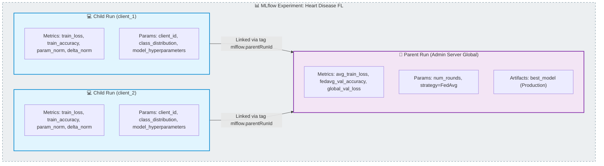
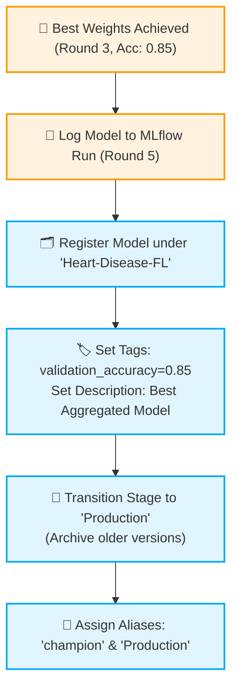

# 📈 Standar & Praktik Terbaik MLflow (v2.x)

Dokumen ini memaparkan standar dan praktik terbaik dalam mengintegrasikan **MLflow** untuk pelacakan eksperimen (*experiment tracking*), pendaftaran model (*model registry*), dan otomatisasi siklus hidup model (*model lifecycle*) di dalam proyek Pembelajaran Terfederasi (*Federated Learning*).

---

## 1. Desain Eksperimen FL: Struktur Parent-Child Runs

Pembelajaran terfederasi bersifat terdistribusi, di mana server global dan beberapa client lokal mengeksekusi kode di lingkungan komputasi yang terpisah.

Untuk merepresentasikan arsitektur terdistribusi ini secara intuitif di MLflow UI, kita harus menghindari penulisan *run* yang datar (*flat*). Sebagai gantinya, gunakan **Struktur Hierarkis Parent-Child Runs**:



### Teknik Menghubungkan Run Secara Terdistribusi (Tanpa Block `with`)
Pada pemrograman FL terdistribusi, client dan server berjalan di kontainer atau mesin yang terpisah, sehingga kita tidak bisa menggunakan context manager Python `with mlflow.start_run(nested=True):` di tingkat runtime.

Sebagai solusinya, kita harus mengirimkan `server_run_id` (Parent Run ID) dari server ke client via pesan konfigurasi Flower (`fit_config`), lalu client secara manual menghubungkan dirinya ke server menggunakan tags MLflow:

```python
# Di Sisi Client: client.py
import mlflow

parent_run_id = config.get("server_run_id")

if parent_run_id:
    # Buat run baru untuk client dan kaitkan dengan parent run ID milik server
    tags = {"mlflow.parentRunId": parent_run_id}
    client_run = mlflow.start_run(
        run_name=f"Federated_Client_{client_id}_[Timestamp]",
        tags=tags
    )
```

---

## 2. Otomatisasi Siklus Hidup Model & Registry Tingkat Lanjut

Model Registry MLflow menyediakan repositori tersentralisasi untuk mengelola model ML skala produksi. Untuk menjaga kerapihan repositori, ikuti standar kebersihan registry berikut:

> [!CAUTION]
> **JANGAN PERNAH** mendaftarkan model global di setiap ronde pelatihan. Pendaftaran berulang-ulang akan mengotori versi model dengan model berkualitas rendah dan membuang-buang memori penyimpanan.

### Standar Alur Pendaftaran Model Terfederasi:
1.  **Evaluasi Ronde**: Di setiap ronde pelatihan, hitung performa model terfederasi (melalui agregasi validasi client atau evaluasi sentral server).
2.  **Identifikasi Model Terbaik**: Simpan referensi bobot model yang menghasilkan akurasi tervalidasi tertinggi sepanjang ronde pelatihan (`best_weights`).
3.  **Pendaftaran Sekali**: Daftarkan model global terbaik **hanya pada ronde terakhir** pelatihan ke MLflow Model Registry.
4.  **Promosi Otomatis (Stage Transition)**: Secara programatis, transisikan versi model yang baru saja didaftarkan ke tahap `"Production"`, dan arsipkan versi lama secara otomatis.
5.  **Pemberian Aliases**: Sematkan alias `"champion"` dan `"Production"` ke versi model terbaik agar aplikasi downstream dapat mengonsumsi model versi terbaru tanpa perlu mengubah hardcoded versi.



### Implementasi Menggunakan `MlflowClient`

```python
from mlflow import MlflowClient

client = MlflowClient()
model_name = "Heart-Disease-FL"

# 1. Daftarkan model saat logging
model_info = mlflow.sklearn.log_model(
    sk_model=best_model,
    name="model",
    registered_model_name=model_name
)

# 2. Ambil versi terbaru yang baru saja didaftarkan
latest_versions = client.get_latest_versions(model_name, stages=["None"])
latest_version = latest_versions[0].version

# 3. Berikan deskripsi informatif pada versi model tersebut
client.update_model_version(
    name=model_name,
    version=latest_version,
    description=f"Model terbaik yang dipilih dari Ronde {best_round} dengan Akurasi {best_accuracy:.4f}."
)

# 4. Sematkan metadata tag performa
client.set_model_version_tag(model_name, latest_version, "validation_accuracy", f"{best_accuracy:.4f}")
client.set_model_version_tag(model_name, latest_version, "best_round", str(best_round))

# 5. Promosikan langsung ke stage Production & arsipkan versi lama
client.transition_model_version_stage(
    name=model_name,
    version=latest_version,
    stage="Production",
    archive_existing_versions=True
)

# 6. Pasang alias terstruktur
client.set_registered_model_alias(model_name, "champion", latest_version)
client.set_registered_model_alias(model_name, "Production", latest_version)
```

---

## 3. Matematika FL: Pelacakan Metrik Fisik Bobot

Dalam Federated Learning, sangat penting untuk membuktikan kebenaran matematis dari proses optimasi FedAvg. Standardisasi proyek FL mengharuskan pelacakan **dua metrik kebugaran bobot** di sisi client sebelum mengirimkannya ke server:

### 1. Norma Parameter (`param_norm`)
Mengukur panjang L2 norm dari seluruh parameter lokal client setelah diselaraskan pada data lokal:
$$\|\theta_i^{(t)}\|_2 = \sqrt{\sum \left(w_{i, j}^{(t)}\right)^2}$$
*   **Fungsi**: Memastikan bobot model tetap stabil, tidak meledak (*exploding gradients*), dan tidak mengalami degradasi nilai ke 0 (*vanishing gradients*).

### 2. Perbedaan Bobot Model (`delta_norm`)
Mengukur pergeseran L2 norm dari bobot lokal client setelah pelatihan terhadap bobot global yang diterima dari server pada awal ronde tersebut:
$$\|\Delta\theta_i^{(t)}\|_2 = \|\theta_i^{(t)} - \theta_{global}^{(t-1)}\|_2$$
*   **Fungsi**: Mendeteksi tingkat keberagaman data (*Non-IIDness*) antar client. Jika nilai `delta_norm` sangat besar pada salah satu client, hal tersebut mengindikasikan bahwa distribusi data client tersebut sangat berbeda (data drift atau bias) dibandingkan distribusi global.

### Kode Perhitungan Metrik Bobot (NumPy):
```python
import numpy as np

# Meluruskan (flatten) parameter model menjadi satu array 1D
global_flat = np.concatenate([arr.flatten() for arr in global_weights])
local_flat = np.concatenate([arr.flatten() for arr in local_weights])

# Menghitung L2 Norm
param_norm = np.linalg.norm(local_flat)
delta_norm = np.linalg.norm(local_flat - global_flat)

# Log metrik per ronde ke MLflow
mlflow.log_metric("param_norm", param_norm, step=current_round)
mlflow.log_metric("delta_norm", delta_norm, step=current_round)
```
