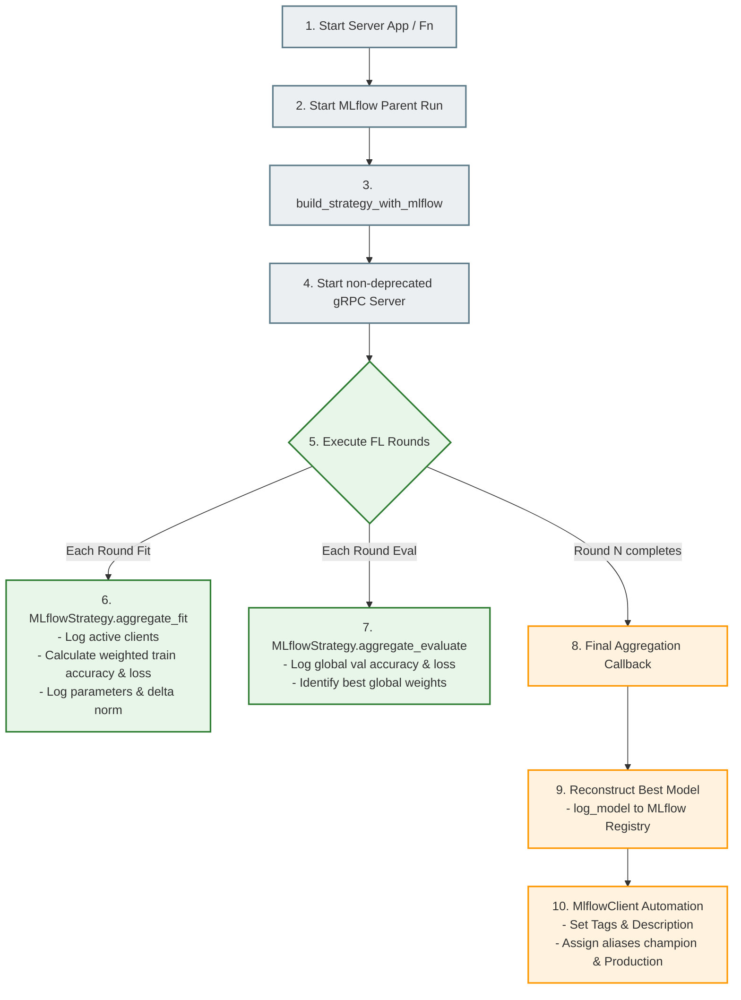

# 💻 Panduan Implementasi Proyek Heart Disease FL

Dokumen ini memaparkan detail implementasi teknis bagaimana kode sumber (*source code*) pada repositori ini mengadopsi standar **Flower.ai (v1.13+)** dan **MLflow (v2.x)** secara utuh, lengkap dengan integrasi log observabilitas menggunakan Grafana Loki dan Grafana Alloy.

---

## 1. Pemetaan Struktur Kode Sumber

Kode sumber utama terletak pada direktori `src/`, diorganisasikan secara modular untuk mendukung keterbacaan tinggi dan struktur pembelajaran terfederasi yang bersih:

```text
src/
├── client/
│   └── client.py          # Entry point Flower ClientApp (High-Level Orchestration)
├── server/
│   └── server.py          # Entry point Flower ServerApp (High-Level Orchestration)
├── configs/
│   └── config.py          # Pusat konfigurasi alamat IP, round, path dataset, & MLflow
├── models/
│   └── model.py           # Inisialisasi arsitektur Logistic Regression (Scikit-Learn)
├── data/
│   └── dataset.py         # Helper loading & preprocessing data UCI Heart Disease
└── utils/
    ├── server_utils.py    # [BARU] Detil implementasi MLflowStrategy & Centralized Eval
    ├── client_utils.py    # [BARU] Detil implementasi HeartDiseaseClient & NumPyClient
    ├── data_utils.py      # Pengambilan statistik data per-client (distribusi kelas)
    ├── model_utils.py     # Ekstraksi, injeksi, & flattening parameter model Scikit-Learn
    └── eval_utils.py      # Penghitungan metrik (akurasi, ROC-AUC, F1) & visualisasi plot
```

> [!NOTE]
> Proyek ini menerapkan **Refaktorisasi Tingkat Lanjut**. Berkas `server.py` dan `client.py` bertindak murni sebagai pengorkestrasi tingkat tinggi (*high-level orchestrators*) yang bersih, sementara seluruh logika bisnis, kalkulasi bobot, callback federated learning, dan tracking didelegasikan secara modular ke berkas helper `utils/server_utils.py` dan `utils/client_utils.py`.

---

## 2. Alur Eksekusi Server ter-MLflow (`server.py` & `server_utils.py`)

File `src/server/server.py` murni menginisialisasi server global Flower dan memicu eksekusi *Parent Run* MLflow dengan mendelegasikan logika ke `utils.server_utils.build_strategy_with_mlflow`.



### Poin Penting Implementasi Server:
1.  **Inisialisasi MLflow Parent Run**:
    Eksperimen dibungkus dalam Parent Run MLflow di level tertinggi. ID dari run ini (`server_run_id`) diambil untuk didistribusikan ke client.
2.  **MLflowStrategy (Turunan `FedAvg`)**:
    Menangkap bobot global terbaik berdasarkan akurasi validasi teragregasi tertinggi lintas seluruh ronde (`best_accuracy`, `best_weights`, `best_round`).
3.  **Agregasi & Perhitungan Rata-Rata**:
    Menghitung rata-rata sederhana (*Simple Average*) dan rata-rata tertimbang (*Weighted Average* / rumus asli FedAvg) berdasarkan jumlah sampel data pelatihan di masing-masing client.
4.  **Registrasi & Promosi Otomatis (`_register_best_model`)**:
    Menggunakan API `MlflowClient` untuk memperbarui deskripsi versi model, menyematkan tag performa (`validation_accuracy`, `best_round`, `total_participating_clients`), serta memasang alias `"champion"` dan `"Production"`.

---

## 3. Alur Eksekusi Client Dinamis (`client.py` & `client_utils.py`)

File `src/client/client.py` memuat client kontainer dan mendelegasikan siklus pelatihan lokal ke modul `utils.client_utils.create_client`.

```mermaid
graph TD
    %% Client Flow
    Start[1. Start Client App / Fn] --> LoadData[2. Load Local Cleansed Dataset]
    LoadData --> ConnectServer[3. Connect to Flower Server via gRPC]
    ConnectServer --> FitRound{4. Called fit() callback?}

    %% Fit
    FitRound -->|Yes| StartChild[5. Start MLflow Child Run<br>- Set parentRunId tag<br>- Log client metadata once]
    StartChild --> LocalTrain[6. Train Scikit-learn estimator]
    LocalTrain --> WeightMath[7. Compute param_norm & delta_norm]
    WeightMath --> LogMetrics[8. Log local accuracy & loss with step=round]
    LogMetrics --> ReturnWeights[9. Return local weights & examples to Server]

    %% Eval
    FitRound -->|No - Called evaluate()| EvalRound[10. Compute Validation Loss & Accuracy]
    EvalRound --> FinalRound{11. Is final round?}
    FinalRound -->|Yes| ClientBestEval[12. Final Client-Side Evaluation<br>- Call evaluate_and_log_metrics<br>- Generate Precision-Recall & ROC plots<br>- Log plots to MLflow child run]
    FinalRound -->|No| ReturnEval[13. Return local validation stats to Server]

    %% Styling
    classDef flow fill:#e1f5fe,stroke:#0288d1,stroke-width:2px;
    classDef loop fill:#e8f5e9,stroke:#2e7d32,stroke-width:2px;
    class Start,LoadData,ConnectServer flow;
    class FitRound,StartChild,LocalTrain,WeightMath,LogMetrics,ReturnWeights,EvalRound,FinalRound,ClientBestEval,ReturnEval loop;
```

### Poin Penting Implementasi Client:
1.  **Pelacakan Dinamis / Child Run Otomatis**:
    Menerima `server_run_id` dari server melalui instruksi konfigurasi `fit()`. Jika client belum memiliki run aktif, ia membuat Child Run baru secara dinamis dan menyematkan tag `{"mlflow.parentRunId": parent_run_id}`.
2.  **Pelacakan Parameter Lokal**:
    Pada ronde pertama (`current_round <= 1`), client mencatat jumlah sampel pelatihan, statistik distribusi kelas target (`class_0` dan `class_1`), serta parameter model penaksir Scikit-learn ke dalam MLflow.
3.  **Metrik Fisik Bobot**:
    Menghitung dan mencatat `param_norm` dan `delta_norm` untuk memvalidasi degradasi bobot lokal dan tingkat bias dataset antar client.
4.  **Evaluasi Akhir Sisi Client (`is_final_round`)**:
    Pada ronde terakhir, server mendistribusikan bobot model **terbaik** (`best_weights`) kembali ke client untuk dievaluasi secara lokal. Client mengaktifkan child run-nya kembali dan memanggil `evaluate_and_log_metrics` untuk membuat visualisasi komprehensif (Confusion Matrix, ROC Curve, Precision-Recall Curve) dan mengunggahnya sebagai artefak ke MLflow.

---

## 4. Orkestrasi Jaringan & Observabilitas Docker Compose

Seluruh ekosistem layanan diikat menggunakan Docker Compose untuk memudahkan deployment dan orkestrasi logs menggunakan Grafana Alloy Stack.

```text
🐳 Docker Engine Daemon (/var/run/docker.sock)
        │
        ├── [fl_server] (gRPC 8080) ── Pelacakan & Model Registry ──> [mlflow] (Port 5000)
        ├── [client_1] (Local Data Partisi Hungaria)
        └── [client_2] (Local Data Partisi Swiss)
        │
        ▼ (Log Streams)
  [alloy] (Grafana Alloy Log Agent)
        │
        ▼ (Pushes via Port 3100)
    [loki] (Log Database Tersentralisasi)
        │
        ▼ (Reads Log database)
  [grafana] (Port 3000 - Dashboard Docker Container Logs)
```

### Keunggulan Observabilitas Terintegrasi:
*   **Docker Socket Connection**: Kontainer `alloy` dipasang langsung ke soket internal host `/var/run/docker.sock` untuk melacak aliran log kontainer secara otomatis tanpa memodifikasi kode python.
*   **Relabeling Logs**: Grafana Alloy secara otomatis mem-parsing metadata kontainer (seperti nama kontainer `fl_server`, `client_1`, `client_2`, `mlflow`) sebagai label terstruktur.
*   **Grafana Logging UI**: Pengembang dapat masuk ke Grafana (Port 3000), menggunakan datasource Loki, dan menyaring log berdasarkan kontainer secara dinamis untuk debugging yang cepat dan komprehensif.
