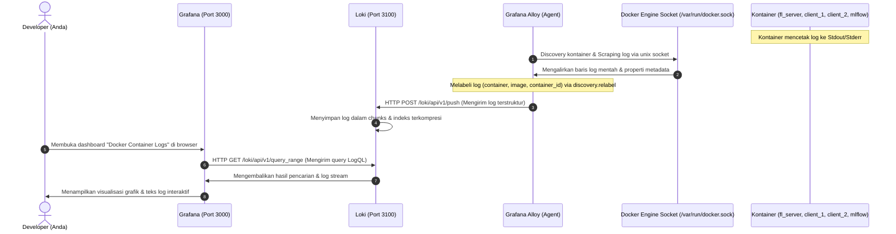

# Alur Kerja & Arsitektur Monitoring Grafana Loki dengan Grafana Alloy

Dokumen ini menjelaskan arsitektur dan alur kerja sistem monitoring log kontainer Docker terpusat menggunakan **Grafana Loki** dan **Grafana Alloy** (sebagai pengganti modern untuk Promtail) serta pemetaan port yang digunakan dalam proyek Federated Learning ini.

---

## 🔌 1. Pemetaan Port Sistem

Berikut adalah tabel port yang digunakan oleh seluruh layanan di dalam sistem:

| Layanan | Port Eksternal (Host) | Port Internal (Kontainer) | Protokol | Deskripsi |
| :--- | :--- | :--- | :--- | :--- |
| **Grafana** | `3000` | `3000` | HTTP | Dashboard Visualisasi Log (diakses melalui browser) |
| **Loki** | `3100` | `3100` | HTTP | Basis data penyimpan log (menerima log dari Grafana Alloy, di-query oleh Grafana) |
| **MLflow Server** | `5000` | `5000` | HTTP | Pelacakan Eksperimen ML & Registry Model |
| **FL Server (Flower)** | `8080` | `8080` | TCP (gRPC) | Server Pembelajaran Terfederasi tempat Client terhubung |
| **Grafana Alloy** | *Tidak ada* | *Internal* | HTTP | Agen pengumpul log kontainer modern (menggantikan Promtail) |

---

## 🔄 2. Diagram Alur Data (Data Flow Diagram)

Berikut adalah visualisasi bagaimana log kontainer dikumpulkan secara otomatis, dikirim, disimpan, dan divisualisasikan secara real-time:



---

## 🛠️ 3. Penjelasan Proses Fetch Data (Langkah demi Langkah)

Proses pengumpulan log (fetch data) bekerja sepenuhnya secara dinamis dan otomatis tanpa perlu mengubah kode Python Anda:

### Langkah A: Pembuatan Log (Log Generation)
Seluruh aplikasi Python (Server, Client) serta MLflow mencetak informasi running ke keluaran standar (`stdout` / `stderr`). Docker Engine menangkap output ini dan menyimpannya di host Linux dalam format JSON-file.

### Langkah B: Penemuan Kontainer secara Otomatis (Docker Service Discovery)
Grafana Alloy dikonfigurasi menggunakan komponen `discovery.docker "containers"` yang terhubung langsung ke soket Docker daemon (`/var/run/docker.sock`). Setiap 5 detik (`refresh_interval = "5s"`), Alloy mendeteksi kontainer yang aktif dan mendapatkan propertinya.

### Langkah C: Pelabelan dan Transformasi Log (Relabeling)
Menggunakan komponen `discovery.relabel "docker_labels"`, Alloy menyaring dan merapikan metadata kontainer menjadi label Loki terstruktur:
*   `__meta_docker_container_name` dengan regex `/(.*)` diubah menjadi label `container`.
*   `__meta_docker_container_image` diubah menjadi label `image`.
*   `__meta_docker_container_id` diubah menjadi label `container_id`.

Hal ini sangat mempercepat query pencarian logs pada database Loki.

### Langkah D: Scrape dan Pengiriman Log (Scraping & Shipping)
Komponen `loki.source.docker "docker_logs"` mengalirkan baris log dari kontainer-kontainer terpilih dan meneruskannya ke komponen `loki.write "local"` untuk dikirimkan melalui protokol HTTP POST ke API Loki (`http://loki:3100/loki/api/v1/push`).

### Langkah E: Query dan Visualisasi di Grafana
Saat Anda mengakses Grafana pada port `3000`, Grafana mengirimkan permintaan pencarian berbasis bahasa **LogQL** ke Loki.

*Sebagai contoh:*
*   Untuk menampilkan semua log Flower Client 1: `{container="client_1"}`
*   Untuk menampilkan log dari Client 1 dan Client 2 yang mengandung kata "warning" secara real-time: `{container=~"client_1|client_2"} |~ "WARNING"`

---

## ⚙️ 4. Konfigurasi Grafana Alloy (`config.alloy`)

Berikut adalah konfigurasi Alloy yang digunakan dalam proyek ini:

```alloy
// Discover Docker containers
discovery.docker "containers" {
  host = "unix:///var/run/docker.sock"
  refresh_interval = "5s"
}

// Relabel container names and metadata to clean up labels
discovery.relabel "docker_labels" {
  targets = discovery.docker.containers.targets
  rule {
    source_labels = ["__meta_docker_container_name"]
    regex         = "/(.*)"
    target_label  = "container"
  }
  rule {
    source_labels = ["__meta_docker_container_image"]
    target_label  = "image"
  }
  rule {
    source_labels = ["__meta_docker_container_id"]
    target_label  = "container_id"
  }
}

// Scrape logs from discovered containers
loki.source.docker "docker_logs" {
  host       = "unix:///var/run/docker.sock"
  targets    = discovery.relabel.docker_labels.output
  forward_to = [loki.write.local.receiver]
}

// Write logs to Loki
loki.write "local" {
  endpoint {
    url = "http://loki:3100/loki/api/v1/push"
  }
}
```

---

## 🐛 5. Catatan Resolusi Masalah: Tabrakan Namespace Data (Namespace Collision)

Jika Anda melihat error berikut pada kontainer client:
`ImportError: cannot import name 'dataset' from 'data' (unknown location)`

### Mengapa ini terjadi?
1.  Kontainer `client_1` dan `client_2` melakukan mounting volume `./data` (direktori lokal berisi CSV) ke `/app/data` di dalam kontainer.
2.  Di saat yang sama, kode client di `/app/src/client/client.py` mencoba memanggil `from data import dataset` (untuk merujuk ke modul `src/data/dataset.py`).
3.  Karena `/app/data` (volume data mentah) ditemukan lebih awal di jalur pencarian Python (`sys.path`) dibandingkan `/app/src/data`, Python mencoba mengimpor dari direktori CSV tersebut dan gagal karena tidak menemukan `dataset.py`.

### Bagaimana ini diatasi?
Kami menambahkan kode berikut di bagian paling atas berkas `src/client/client.py`:
```python
import sys
import os
sys.path.insert(0, os.path.abspath(os.path.join(os.path.dirname(__file__), '..')))
```
Kode ini memastikan bahwa direktori `/app/src` diprioritaskan di indeks pertama (`0`) dari `sys.path`. Dengan begitu, Python akan mencari paket `data` di dalam folder source (`src/data`) terlebih dahulu, menyelesaikan tabrakan nama dengan volume data mentah secara bersih dan elegan!
