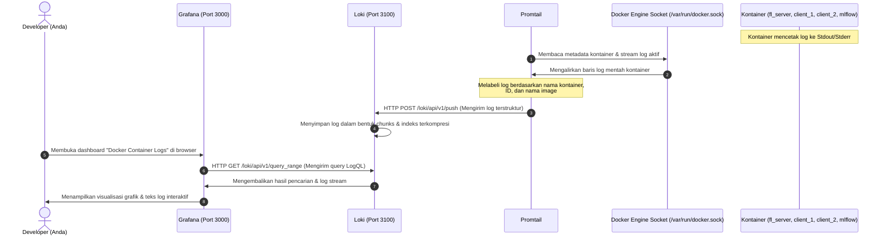

# Alur Kerja & Arsitektur Monitoring Grafana Loki

Dokumen ini menjelaskan alur kerja sistem monitoring log kontainer Docker menggunakan **Grafana Loki** dan **Promtail**, serta pemetaan port yang digunakan dalam proyek Federated Learning ini.

---

## 🔌 1. Pemetaan Port Sistem

Berikut adalah tabel port yang digunakan oleh seluruh layanan di dalam sistem:

| Layanan | Port Eksternal (Host) | Port Internal (Kontainer) | Protokol | Deskripsi |
| :--- | :--- | :--- | :--- | :--- |
| **Grafana** | `3000` | `3000` | HTTP | Dashboard Visualisasi Log (diakses melalui browser) |
| **Loki** | `3100` | `3100` | HTTP | Basis data penyimpan log (menerima log dari Promtail, di-query oleh Grafana) |
| **MLflow Server** | `5000` | `5000` | HTTP | Pelacakan Eksperimen ML & Registry Model |
| **FL Server (Flower)** | `8080` | `8080` | TCP (gRPC) | Server Pembelajaran Terfederasi tempat Client terhubung |
| **Promtail** | *Tidak ada* | `9080` | HTTP | Pengumpul log kontainer (berjalan secara internal tanpa ekspos port keluar) |

---

## 🔄 2. Diagram Alur Data (Data Flow Diagram)

Berikut adalah visualisasi bagaimana log kontainer dikumpulkan, disimpan, dan divisualisasikan secara real-time:



---

## 🛠️ 3. Penjelasan Proses Fetch Data (Langkah demi Langkah)

Proses pengumpulan log (fetch data) bekerja sepenuhnya secara dinamis dan otomatis tanpa perlu mengubah kode Python Anda:

### Langkah A: Pembuatan Log (Log Generation)
Seluruh aplikasi Python (Server, Client) serta MLflow mencetak informasi running ke keluaran standar (`stdout` / `stderr`). Docker Engine menangkap output ini dan menyimpannya di host Linux dalam format JSON-file.

### Langkah B: Penemuan Kontainer secara Otomatis (Docker Service Discovery)
Promtail dikonfigurasi dengan fitur `docker_sd_configs`. Dengan memasangkan soket Docker daemon (`/var/run/docker.sock`), Promtail dapat berkomunikasi langsung dengan Docker Engine di komputer Anda untuk:
1. Mendeteksi setiap kontainer yang baru berjalan.
2. Membaca properti kontainer seperti nama kontainer (`__meta_docker_container_name`), nama image (`__meta_docker_container_image`), dan ID kontainer.

### Langkah C: Pelabelan dan Transformasi Log
Sebelum log dikirim ke Loki, Promtail menggunakan `relabel_configs` untuk merapikan metadata kontainer menjadi label Loki yang bersih:
* `/fl_server` diubah menjadi `container="fl_server"`
* `/client_1` diubah menjadi `container="client_1"`

Hal ini sangat mempercepat proses pencarian log nantinya di Grafana.

### Langkah D: Pengiriman Log ke Loki
Setiap baris log baru dialirkan (stream) oleh Promtail secara berkala menggunakan protokol HTTP POST ke API Loki (`http://loki:3100/loki/api/v1/push`).

### Langkah E: Query dan Visualisasi di Grafana
Saat Anda mengakses Grafana pada port `3000`, Grafana mengirimkan permintaan pencarian berbasis bahasa **LogQL** ke Loki.

*Sebagai contoh:*
* Untuk menampilkan log Flower Client 1: `{container="client_1"}`
* Untuk menampilkan log yang hanya berisi kata "error" secara real-time: `{container=~"client_1|client_2"} |~ "error"`

Visualisasi grafik, jumlah error, dan teks log interaktif yang Anda lihat di layar Anda adalah hasil akhir dari alur terintegrasi ini!

---

## 🐛 4. Catatan Resolusi Masalah: Tabrakan Namespace Data (Namespace Collision)

Jika Anda melihat error berikut pada kontainer client:
`ImportError: cannot import name 'dataset' from 'data' (unknown location)`

### Mengapa ini terjadi?
1. Kontainer `client_1` dan `client_2` melakukan mounting volume `./data` (direktori lokal berisi CSV) ke `/app/data` di dalam kontainer.
2. Di saat yang sama, kode client di `/app/src/client/client.py` mencoba memanggil `from data import dataset` (untuk merujuk ke modul `src/data/dataset.py`).
3. Karena `/app/data` (volume data mentah) ditemukan lebih awal di jalur pencarian Python (`sys.path`) dibandingkan `/app/src/data`, Python mencoba mengimpor dari direktori CSV tersebut dan gagal karena tidak menemukan `dataset.py`.

### Bagaimana ini diatasi?
Kami menambahkan kode berikut di bagian paling atas berkas `src/client/client.py`:
```python
import sys
import os
sys.path.insert(0, os.path.abspath(os.path.join(os.path.dirname(__file__), '..')))
```
Kode ini memastikan bahwa direktori `/app/src` diprioritaskan di indeks pertama (`0`) dari `sys.path`. Dengan begitu, Python akan mencari paket `data` di dalam folder source (`src/data`) terlebih dahulu, menyelesaikan tabrakan nama dengan volume data mentah secara bersih dan elegan!
